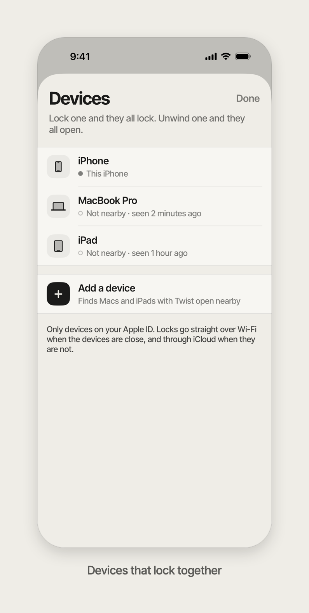

# Twist

**Twist. Then live.**

Twist is a focus timer that works like a kitchen timer. You turn a dial to set how long, press Lock, and your iPhone locks down until the time is up. Every app except a short allowlist is shielded and the internet is cut off. A Mac version locks the whole Mac with the same dial, and linked devices lock and unwind together.

There are no profiles, schedules, streaks or stats. You set a time, the phone locks, and you get on with your day.


The Mac version uses the same dial, full screen. Here the lock was started from the iPhone:


These are screenshots of the real app (iOS Simulator, and the Mac views rendered with SwiftUI's `ImageRenderer`) with made-up data. The shield over blocked apps is drawn by iOS through Screen Time, which doesn't run in the Simulator, so it isn't shown.

## Why

Most focus apps are settings screens. You build profiles, pick schedules, tune rules, and in the end it's easier to scroll than to configure. Twist copies an egg timer instead, an object that needs no explanation. You turn it, it ticks down, and when it's done you're done.

It also has to actually hold. Shields that close with one tap and a "focus mode" you can swipe off don't help much when you're tired. Twist uses the system's own Screen Time machinery and a VPN that drops every packet. The session ends on its own even if the app is killed, and getting out early is deliberately slow.

## What it does

- **The dial.** One full turn is 4 hours. It snaps to 5 minutes and ticks under your finger with haptics. Lock appears once you've set at least 15 minutes.
- **Real lockdown.** Every app except your allowlist is shielded, and apps can't be deleted during a session. If you allow a whole category, the shield recognises an app from it the first time it comes up, lets it through, and remembers it.
- **No internet.** A local "blackhole" VPN routes every packet into a tunnel and drops it.
- **Branded shield.** Blocked apps show "Locked by Twist" with the time left, in light or dark to match the phone.
- **Live Activity.** The countdown sits on the Lock Screen and in the Dynamic Island.
- **Unwind.** If you really need out, tap "I need access" and hold for 45 seconds while the screen fills with orange. Let go and you stay locked.
- **Twist for Mac.** A full-screen kiosk lock. The countdown shows on the main display and every other display gets a plain lock. To unwind early, hold the mouse button or Space for 45 seconds.
- **Linked devices.** Pair your iPhone with a Mac (and other devices running Twist). Lock one and they all lock. Unwind one and they all open.

## Across devices



Devices that lock together form a "ring" (`Ring/`):

- Devices find each other over Bonjour (`_twist._tcp`) on the local network. You add one from the Devices sheet while Twist is open on both.
- Pairing is a Curve25519 key exchange. Both screens show a 4-digit code derived from the shared secret, so a relay in the middle would show different digits. You join only if the codes match.
- After pairing, every message between members is signed with HMAC-SHA256.
- The ring's state is one small document: the members, and the current lock (when it ends and which device started it). Each half is last-writer-wins on its own timestamp, so copies can merge in any order.
- Nearby devices get changes straight over the local network. Devices that aren't nearby get them through a CloudKit private database zone with a push subscription. The Mac also polls iCloud every minute in case a push doesn't arrive.
- When a lock arrives from another device, the iPhone applies the shields and starts the VPN. If the app is in the background, a silent push wakes it, and the packet tunnel extension also watches iCloud.
- In a ring the Mac starts at login and stays in the menu bar, so other devices can lock it at any time.

<br clear="right">

## How it works

The project has seven targets: the iOS app, five iOS extensions, and the Mac app.

| Target | What it does |
| --- | --- |
| `Twist` (iOS) | The dial, onboarding, allowlist, locked and unwind screens. Asks for Screen Time authorization (FamilyControls), applies shields through `ManagedSettingsStore`, schedules the session, and starts the VPN. |
| `TwistMonitor` | A `DeviceActivityMonitor`. The session is a DeviceActivity interval, so the system lifts the shields when it ends, even if the app has been killed. |
| `TwistShieldConfig` | A `ShieldConfigurationDataSource` that draws the branded shield with the time left, and lets through apps from an allowed category. |
| `TwistShieldAction` | Handles the shield's buttons ("OK", "I need access"). |
| `TwistTunnel` | An `NEPacketTunnelProvider` that does nothing but drop traffic. During a session every route goes into the tunnel and every packet is discarded. When the session ends it switches to pass-through, so on-demand reconnects can't cut the internet before the app turns the VPN off. In a ring it also watches iCloud while the app isn't running. |
| `TwistIsland` | The Live Activity: a Lock Screen countdown and the Dynamic Island. |
| `TwistMac` (macOS) | Kiosk presentation options hide the Dock and menu bar and disable ⌘Tab, Force Quit and log out/restart. Lock windows sit above everything on every Space and take focus back if another app grabs it. ⌘Q is refused during a session. The app registers as a login item for the session, so a forced restart brings the lock back. |

The app and its extensions share session state through an App Group (`Shared/Session.swift`). The Mac app reuses the iOS dial (`App/Views/DialView.swift`) and theme.

## Design

The look is a Braun-style kitchen timer: paper `#EFEDE7`, graphite `#1B1B1A`, one orange signal colour `#FF5A1F`, and Inter Tight. The orange wedge shows the time you set, then shrinks as the time runs out.


Every screen started as an HTML board in [`design/canvas/`](design/canvas): the brand directions (Yolk, Dial, Vault), dial studies, the unwind redesign, the linked-devices flow and the Live Activity. The boards are generated by the scripts in [`design/src/`](design/src).

## Requirements

- Xcode 16 or later
- iOS 18 or later on a real iPhone. Screen Time APIs and packet tunnels don't work in the Simulator. The iOS target is built for iPhone only for now.
- macOS 15 or later for Twist for Mac
- A paid Apple Developer account, which the Family Controls and Network Extension (packet tunnel) entitlements need. Shipping outside development builds also requires Apple's Family Controls distribution approval.

## Build and install

The Xcode project is generated from [`project.yml`](project.yml) with [XcodeGen](https://github.com/yonaskolb/XcodeGen). The generated `Twist.xcodeproj` is committed, so you only need XcodeGen if you change the targets.

1. In `project.yml`, set `DEVELOPMENT_TEAM` to your team and change `bundleIdPrefix`, the App Group (`group.…`) and the iCloud container (`iCloud.…`) to identifiers you own. Update the same identifiers in the `*.entitlements` files, `Shared/Session.swift` and `Ring/Cloud.swift`.
2. Regenerate the project:
   ```sh
   brew install xcodegen
   xcodegen generate
   ```
3. Open `Twist.xcodeproj`, choose the `Twist` scheme and your iPhone, then run. On first launch, onboarding asks for Screen Time access, the VPN configuration, and your allowlist.
4. For the Mac, run the `TwistMac` scheme.

Debug builds have two launch arguments for trying things out:

- `-twistTestSeconds 20` (Mac) locks the Mac for 20 seconds.
- `-twistLiveActivityPreview` (iOS) shows the Live Activity for a made-up 1 h 12 min lock, so you can see it in the Simulator.

## Credits

- [Foqos](https://github.com/awaseem/foqos) (MIT) was a useful reference for the Screen Time parts.
- [Inter Tight](https://github.com/rsms/inter) by Rasmus Andersson, under the SIL Open Font License.

## License

[MIT](LICENSE) © 2026 Andrew Liubkin
